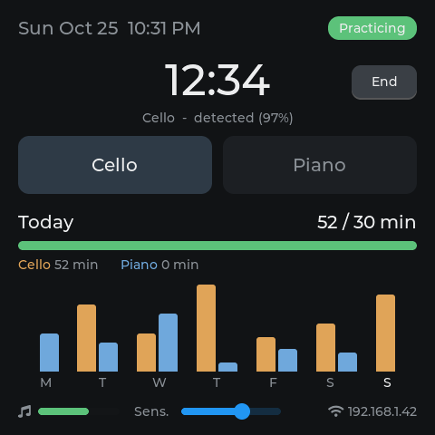

# Practice Logger

Fully automatic cello/piano practice time logging for the **Waveshare ESP32-S3-Touch-LCD-4B**.

Leave it somewhere it can hear both instruments. It listens through the onboard mic.

- It starts a session when you play and ends it when you stop.
- It works out whether you were playing **cello or piano** by itself.
- It keeps daily totals per instrument.

You don't need to touch it at all.



## How it works

1. **Listen.** The microphone runs at 16 kHz and is decimated to 8 kHz. Every 32 ms the
   detector measures level against an adaptive noise floor, and periodicity and pitch
   with the YIN algorithm.
2. **Classify.** A frame counts as *music* when it is loud, clearly pitched, and holds its pitch.
   Speech glides in pitch, and noise has none, so neither counts.
3. **Session logic**
   - Playing for 5 s starts a session, back-dated to when you began.
   - Pauses under 90 s stay inside the session (page turns, tuning, a quick rest).
   - After 90 s of silence the session ends. The trailing silence is not counted.
   - Sessions under 1 minute are discarded.
4. **Instrument, detected automatically.** The audio is cut into notes, and each note is
   measured for the things that physically differ between a struck and a bowed string:

   | Cue | Piano | Cello |
   |---|---|---|
   | Level during a note | fades as soon as it is struck | holds or swells under the bow |
   | Tone colour during a note | darkens (upper partials die first), even with the pedal | stays the same |
   | Start of a note | hammer jump over what was sounding | soft bow change |
   | Vibrato (regular 4–7 Hz pitch wobble) | never | often |

   - Every note votes, and long notes count more, because they can be measured better.
   - The votes add up over the session. Since you never play both at once, the whole
     session gets one label.
   - A small **time-of-day** hint learns when you usually play each instrument and breaks
     close calls.
   - Some cues only ever vote one way. Vibrato always counts for cello, but no vibrato
     says nothing, because scales are often played straight. A hammer-like attack always
     counts for piano, but a soft start says nothing.
5. **Correcting and learning**
   - **After a session:** for 15 minutes the screen shows *"Last: Cello 24 min – wrong?
     tap Piano"*. One tap fixes that day's totals and the log.
   - **During a session:** tapping an instrument sets it for the session in progress.
   - **Learning:** the board adapts its cello and piano profiles to *your* instruments and
     room.
     - It learns most from your corrections.
     - It also learns a little from sessions it was very sure about.
     - It never learns from sessions it was unsure of and you didn't confirm.
6. **Storage**
   - Daily totals are kept in flash for about 2 years.
   - Every session is appended to a CSV file.
   - The running session is checkpointed every 30 s, so unplugging loses at most 30 s.

## Build & flash

Requires ESP-IDF 5.3 or newer. It was built and tested with v5.4.2.

```bash
cd practice_logger
idf.py set-target esp32s3
idf.py menuconfig          # Practice Logger -> Wi-Fi SSID / password, goal, time zone
idf.py -p /dev/ttyACM0 flash monitor     # macOS: /dev/cu.usbmodem*
```

The component manager downloads the board BSP and LVGL automatically. Versions are
pinned in `main/idf_component.yml` and `dependencies.lock`.

### Wi-Fi (recommended)

Wi-Fi is optional, but it does two things:

- **Sets the clock**, which the logger needs to split time into days.
  - Without it, everything goes into one undated "today" bucket.
- **Serves your log** at `http://<ip shown on screen>/`:
  - a table of the last 30 days
  - a download of every session as a CSV file (`/sessions.csv`)

The time zone defaults to US Pacific. You can change it in menuconfig.

## First-time tuning (2 minutes)

Watch the mic bar at the bottom left. It shows level above the room's noise floor and
turns **green** when the sound is loud enough to count.

| Symptom | Fix |
|---|---|
| Bar stays grey while you play quietly | Slide **Sens.** to the right |
| Talking, TV or a fan starts sessions | Slide **Sens.** to the left |
| Bar is always pinned full | Lower `PL_MIC_GAIN_DB` in menuconfig (default 30) |
| Sessions end during long rests | Raise `PL_STOP_GAP_S` |

For detailed numbers, set the log level for the `main` tag to *Debug*. The serial monitor
then prints level, floor, harmonicity, pitch and activity every 5 s.

## Files

| File | What it does |
|---|---|
| `main/detector.c` | Music detector: level, noise floor, YIN pitch, activity window. Plain C. |
| `main/session.c` | Start/stop state machine. Plain C. |
| `main/classifier.c` | Cello vs piano: per-note cues, session vote, time-of-day hint, learning. Plain C. |
| `main/main.c` | Audio task, command handling, wiring |
| `main/store.c` | Flash storage (daily totals), CSV log, crash recovery |
| `main/net.c` | Wi-Fi, clock sync, the small web page |
| `main/ui.c` | Touchscreen UI (LVGL 9) |
| `test/` | PC tests with synthetic cello, piano, speech and noise: `make -C test` |
| `test/classify_test.c` | Cello vs piano across playing styles, mixed sessions, and learning |

## How well does instrument detection work?

It has been tested on **synthetic** audio, not yet on a real cello and piano. The test
signals model:

- bow noise and vibrato
- hammer attacks and string beating
- upper partials that decay faster than the fundamental
- the sustain pedal

Results, in a quiet room and in a noisy one:

| Test | Result |
|---|---|
| Cello: vibrato, straight tone, fast detaché | correct |
| Piano: melody, chords, low notes with pedal | correct |
| 4-minute mixed sessions (scales + pieces + chords) | 20/20 correct |
| A session of *only* fast piano scales | **wrong**: very short notes carry too little evidence |
| Same, after correcting three such sessions | correct (cello still correct) |

So expect the first sessions on your real instruments to need the odd tap. Each
correction teaches it. To speed this up, play each instrument for a few minutes and
confirm or correct the label on the screen afterwards.

## Known limits

- Recorded music, such as a cello recording on a speaker, looks like live playing. Mute
  playback or press **End**.
- Very quiet, very sparse playing (long held rests, soft harmonics) may need a more
  sensitive setting.
- Detection was tuned on synthetic signals. Real rooms differ, so expect to adjust
  **Sens.** once.
- If you switch from cello to piano with less than 90 s of silence in between, that
  becomes one session with one label. Press **End** between instruments, or pause briefly.
